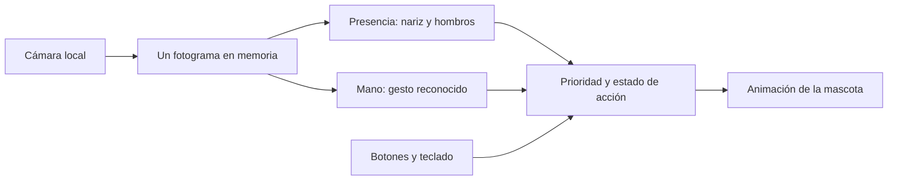

# Bobber — mascota interactiva para ferias

Aplicación de escritorio en Python que muestra una mascota 3D y reacciona cuando alguien se acerca a la cámara o hace un gesto con la mano. Está pensada para funcionar en un stand, con controles manuales disponibles si la cámara falla.

El procesamiento de cámara se hace en el propio ordenador. La aplicación no identifica personas, no guarda imágenes ni envía fotogramas a internet.

## Qué hace

- Muestra la mascota 3D usando Panda3D y carga modelos glTF/GLB.
- Detecta presencia con MediaPipe Pose a partir de la nariz y los hombros.
- Reconoce gestos de una mano con MediaPipe Gesture Recognizer.
- Saluda tras una presencia estable y rearma el saludo cuando la persona deja de detectarse durante el tiempo configurado.
- Ejecuta acciones por gestos, con confirmación, cooldown y liberación para evitar repeticiones accidentales.
- Mantiene una sola captura de cámara y procesa la imagen en un hilo de fondo.
- Tiene modo manual, calibración visual, pantalla completa y una prueba de diagnóstico.

## Interacción y prioridad



Los controles manuales tienen prioridad sobre los gestos, y los gestos sobre el saludo automático por presencia. La detección de persona y de mano usa la misma cámara y el mismo fotograma.

## Modelo y animaciones

El modelo activo es `assets/mascota.gltf`. El archivo incluye sus datos y una textura, y contiene estos clips:

| Clip del modelo | Uso en la aplicación |
| --- | --- |
| `idle` | Reposo |
| `jump` | Saludo provisional |
| `walk` | Caminar |

`jump` es un salto, no un saludo con la pata. Para que Bobber salude de verdad, crea una acción `saludo` en Blender y cambia `[animations].saludo` en `config.toml`. `assets/mascota.glb` se conserva como alternativa, pero no incluye animaciones.

Los gestos vienen configurados así:

| Gesto | Acción |
| --- | --- |
| Palma abierta | Saludo |
| Puño cerrado | Caminar |
| Otros gestos reconocidos | Ninguna, hasta asignarles una acción |

El puño necesita que el modelo tenga un clip de caminar. Si el clip configurado no existe, la aplicación muestra un aviso en vez de inventar una animación.

## Requisitos

- Windows 10/11.
- Python de 64 bits, recomendado Python 3.12; el arranque también intenta Python 3.11.
- Cámara web con permiso para aplicaciones de escritorio.
- Conexión a internet la primera vez para crear el entorno e instalar dependencias. Los modelos de pose y gestos vienen en `assets`.

Dependencias fijadas en `requirements.txt`:

- Panda3D `1.10.16` y `panda3d-gltf` `1.3.0` para la ventana 3D y los clips.
- OpenCV `5.0.0.93` para la cámara y la vista de calibración.
- MediaPipe `0.10.35` para presencia y gestos.

## Instalar y ejecutar

1. Clona o descomprime el repositorio.
2. Ejecuta `run.bat`. La primera vez crea `.venv` e instala las dependencias.
3. Permite el acceso a la cámara cuando Windows lo solicite.

Comandos alternativos, desde la carpeta del proyecto:

| Comando | Para qué sirve |
| --- | --- |
| `run.bat --manual` | Abre la app sin iniciar la cámara |
| `run.bat --ventana` | Abre una ventana normal en vez de pantalla completa |
| `run.bat --calibrar` | Muestra la cámara y los puntos detectados de persona y mano |
| `run.bat --selftest` | Revisa lógica, modelo, cámara y carga de los reconocedores |
| `run.bat --descargar-modelos` | Recupera los modelos de MediaPipe si falta alguno |

El modo de calibración y el `selftest` acceden a la cámara; cierra antes otras aplicaciones que puedan estar usándola.

## Controles

| Tecla o botón | Acción |
| --- | --- |
| `1` / Reposo | Reproduce reposo |
| `2` / Saludo | Prueba el saludo manualmente |
| `3` / Caminar | Prueba el clip de caminar |
| `M` / Auto-Manual | Activa o detiene la cámara |
| `C` / Calibración | Muestra cámara, presencia, puntos de mano y confianza |
| `F11` / Pantalla | Alterna pantalla completa y ventana |
| `Esc` o `Q` | Cierra la aplicación |

Si la cámara falla, la app cambia a modo manual y muestra el error. Los botones siguen disponibles.

## Configuración

Edita `config.toml` y reinicia la aplicación para aplicar los cambios.

| Ajuste | Sección y clave | Valor inicial |
| --- | --- | --- |
| Modelo y orientación | `[model] path`, `heading_degrees` | `assets/mascota.gltf`, `180` (de frente) |
| Clips del personaje | `[animations] reposo`, `saludo`, `caminar` | `idle`, `jump`, `walk` mediante alias |
| Cámara | `[camera] index`, `width`, `height` | `0`, `640`, `480` |
| Detección de persona | `[detection] min_visibility`, `min_shoulder_width` | `0.5`, `0.10` |
| Ritmo de análisis | `[detection] interval_ms` | `150` ms |
| Tiempo hasta saludar | `[timing] detect_seconds` | `0.8` s |
| Rearme tras ausencia | `[timing] lost_tolerance_seconds` | `0.5` s |
| Vuelta a reposo | `[timing] reset_seconds` | `4.0` s |
| Gestos | `[gestures] enabled`, `min_confidence` | `true`, `0.6` |
| Confirmación, espera y rearme | `[gestures] confirm_seconds`, `cooldown_seconds`, `release_seconds` | `0.6`, `3.0`, `0.7` s |
| Acción de cada gesto | `[gestures.actions]` | Palma = `saludo`; puño = `caminar` |

`heading_degrees` gira el modelo sobre su eje vertical. Con `mascota.gltf`, `180` lo deja mirando al público; `0` lo muestra de espaldas y `90`/`-90` de perfil. Si cambias de modelo, prueba esos valores.

Sube `min_shoulder_width` para que solo cuente quien se acerque más a la cámara. Si hay falsos gestos, sube `min_confidence` o `confirm_seconds`. Para ver valores en directo, activa la calibración con `C`.

## Procedimiento en el stand

Este procedimiento se basa en cómo reacciona el código ante cada fallo. Aún hay que validarlo en el ordenador y con la cámara del stand.

### Antes de abrir al público

1. Conecta la webcam y cierra otras aplicaciones que puedan usarla (Teams, Zoom, Cámara de Windows…).
2. Ejecuta `run.bat --calibrar`. Comprueba que se detecta a una persona a la distancia deseada y que la palma y el puño se reconocen. Cierra la ventana al terminar: la app y la calibración no deben usar la cámara a la vez.
3. Ejecuta `run.bat`. Arranca a pantalla completa en modo automático y arriba a la izquierda debe aparecer `Modo auto · cámara activa`.
4. Comprueba que Bobber mira al público. Si no, ajusta `heading_degrees` en `config.toml` y reinicia.
5. Pulsa `2` y `3` para probar el saludo y caminar, y `1` para volver a reposo. Después acércate y prueba palma y puño.
6. Si aparece un texto de aviso en pantalla, consulta la tabla siguiente antes de abrir.

### Solución de problemas

La app no se cierra por un fallo de cámara o de gestos: pasa a modo manual o desactiva solo lo que falla, y muestra el motivo en pantalla. Los botones y las teclas `1`, `2` y `3` siempre siguen disponibles.

| Qué ves | Qué ha pasado | Qué hacer |
| --- | --- | --- |
| `Cámara no disponible: no se pudo abrir la cámara…` | Cámara ocupada, desconectada o sin permiso | Cierra otras apps que usen la cámara, revisa *Configuración > Privacidad > Cámara* («Permitir que las aplicaciones de escritorio accedan a la cámara») y pulsa `M` para reintentar. Si hay varias cámaras, prueba `[camera] index = 1` |
| `La cámara no responde…` | El driver no entregó imagen en `starting_timeout_seconds` | Desconecta y vuelve a conectar la webcam, espera unos segundos y pulsa `M` |
| `Cámara no disponible: se perdió la señal de la cámara` | La cámara se desconectó con la app abierta | Reconéctala y pulsa `M` |
| `La cámara aún se está cerrando…` | Se pulsó `M` antes de que se liberara la cámara | Espera unos segundos y vuelve a pulsar `M` |
| `Gestos desactivados: …` | Falta `gesture_recognizer.task` o falló el reconocedor | La presencia y el modo manual siguen activos. Cierra la app, ejecuta `run.bat --descargar-modelos` (requiere internet) y vuelve a abrirla |
| `Cámara no disponible:` con un error de red o de MediaPipe | Falta `pose_landmarker_lite.task` y no se pudo descargar, o el modelo de pose no carga | Comprueba que el archivo está en `assets`; si falta, ejecuta `run.bat --descargar-modelos` con internet y reinicia |
| `No encuentro el modelo…` o `No se pudo cargar el modelo…` | Falta o está dañado `assets/mascota.gltf` | Restaura el archivo desde el repositorio y revisa `[model] path` |
| `Faltan animaciones…` | El modelo no tiene los clips configurados | Se usa un movimiento provisional. Revisa `[animations]` en `config.toml` frente a los clips del modelo (`idle`, `jump`, `walk`) |
| `run.bat` no puede crear el entorno o instalar dependencias | Falta Python 3.11/3.12 de 64 bits o no hay internet | Instala Python desde python.org, borra la carpeta `.venv` incompleta y vuelve a ejecutar `run.bat` con conexión |

### Plan manual

Si la cámara no se recupera, sigue con el stand en modo manual:

- Arranca con `run.bat --manual` para no intentar abrir la cámara, o pulsa `M` si la app ya está abierta.
- Usa `2` (saludo) cuando llegue alguien y `3` (caminar) para llamar la atención; `1` vuelve a reposo.
- `F11` alterna entre ventana y pantalla completa; `Esc` o `Q` cierran la app.

## Estructura

```text
.
├── assets/
│   ├── gesture_recognizer.task
│   ├── pose_landmarker_lite.task
│   ├── mascota.gltf
│   ├── mascota.glb
│   └── LEEME.txt
├── mascota/
│   ├── app.py          # ventana, render 3D, controles y coordinación
│   ├── behavior.py     # presencia, gestos y prioridad de acciones
│   ├── detector.py     # cámara, pose y reconocedor de gestos
│   ├── calibrate.py    # vista de diagnóstico
│   ├── modelio.py      # inspección y carga glTF/GLB
│   ├── config.py       # valores por defecto y rutas
│   ├── selftest.py     # diagnóstico con y sin hardware
│   └── __main__.py     # comandos de ejecución
├── tests/
│   └── test_logic.py   # pruebas de lógica sin cámara ni ventana
├── config.toml
├── requirements.txt
├── run.bat
├── AGENTS.md
├── CLAUDE.md
├── LICENSE
├── THIRD_PARTY_NOTICES.md
└── ROADMAP.md
```

## Desarrollo y pruebas

Pruebas lógicas sin abrir cámara ni ventana:

```powershell
.venv\Scripts\python.exe -m unittest discover -s tests -v
```

Diagnóstico integral (puede abrir la cámara y una ventana 3D oculta):

```powershell
run.bat --selftest
```

Consulta [ROADMAP.md](ROADMAP.md) para ver el estado, las limitaciones conocidas y los pasos antes de una publicación.

## Licencia

El código de este repositorio se publica bajo la [licencia MIT](LICENSE), © 2026 Maker Club León.

La licencia MIT no cubre los archivos de `assets/` ni las dependencias. [THIRD_PARTY_NOTICES.md](THIRD_PARTY_NOTICES.md) recoge la licencia de cada componente de terceros y las atribuciones. Todavía faltan por confirmar la licencia de `gesture_recognizer.task` y los derechos del modelo de Bobber.
