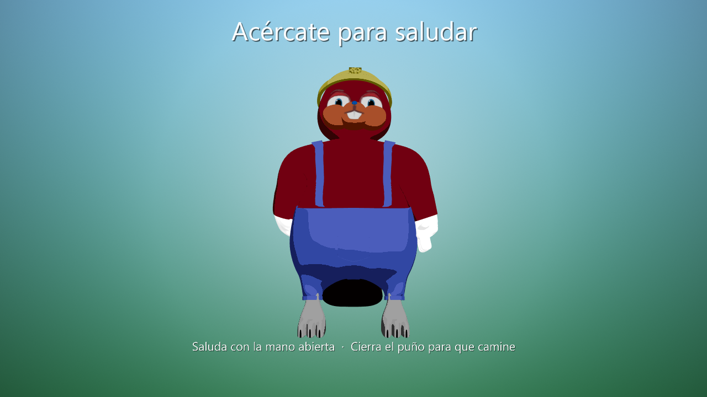
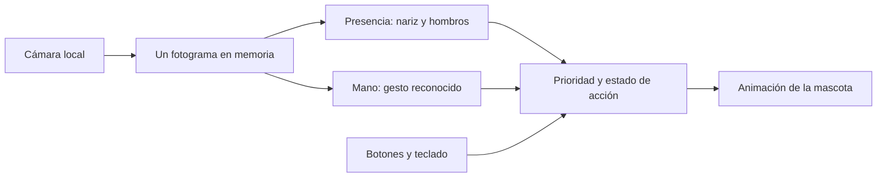

# Bobber — mascota interactiva para ferias

Aplicación de escritorio en Python que muestra una mascota 3D y reacciona cuando alguien se acerca a la cámara o hace un gesto con la mano. Está pensada para funcionar en un stand, con controles manuales disponibles si la cámara falla.

El procesamiento de cámara se hace en el propio ordenador. La aplicación no identifica personas, no guarda imágenes ni envía fotogramas a internet. Con las versiones fijadas en `requirements.txt`, y con los modelos de `assets` presentes, el uso normal no se conecta a internet (ver [Requisitos](#requisitos)).

> [!IMPORTANT]
> **Si instalaste el proyecto (carpeta `.venv`) antes del 13 de noviembre de 2026**, tu entorno tiene MediaPipe `0.10.35`, que envía estadísticas de uso a Google. Cámbialo a la versión fijada ejecutando esto una vez desde la carpeta del proyecto:
>
> ```powershell
> .venv\Scripts\python.exe -m pip install -r requirements.txt
> ```
>
> Después comprueba con `run.bat --selftest` que la línea «Versión de MediaPipe fijada (sin telemetría)» sale como `[OK] 0.10.33`. Más detalles en [Requisitos](#requisitos).



*Modo stand a pantalla completa, esperando visitantes.*

## Qué hace

- Muestra la mascota 3D usando Panda3D y carga modelos glTF/GLB.
- Detecta presencia con MediaPipe Pose a partir de la nariz y los hombros.
- Reconoce gestos de una mano con MediaPipe Gesture Recognizer.
- Saluda tras una presencia estable y rearma el saludo cuando la persona deja de detectarse durante el tiempo configurado.
- Ejecuta acciones por gestos, con confirmación, cooldown y liberación para evitar repeticiones accidentales.
- Mantiene una sola captura de cámara y procesa la imagen en un hilo de fondo.
- Tiene modo manual, calibración visual, pantalla completa y una prueba de diagnóstico.

## Interacción y prioridad



Los controles manuales tienen prioridad sobre los gestos, los gestos sobre el saludo automático por presencia, y este sobre el modo reclamo. La detección de persona y de mano usa la misma cámara y el mismo fotograma.

En modo automático, con los gestos activos, la pantalla explica al visitante qué puede hacer («Saluda con la mano abierta · Cierra el puño para que camine»). Mientras mantiene un gesto que va a actuar, aparece «¡Mantén el gesto!» con una barra que se llena hasta que la mascota responde. Los textos se cambian en `[messages] hint` y `hold`. La tecla `H` oculta o muestra esta ayuda durante la sesión; para quitarla siempre, deja `hint = ""`.

**Modo reclamo:** para llamar la atención, la mascota hace una de sus acciones (alterna saludo y paseo) con el mensaje «¡Ven a saludarme!» en dos casos:

- **Nadie delante durante 15 s** (ni persona ni mano).
- **Nadie interactúa durante 45 s**, aunque haya gente delante. Así se reclama también a quien pasa sin mirar. Interactuar es hacer un gesto o usar las teclas; el saludo automático al detectar a alguien no cuenta.

Nunca actúa con otra acción en curso ni con una mano a la vista, para no estorbar a quien está haciendo un gesto. Es la prioridad más baja: cualquier otra acción lo interrumpe, y si alguien se acerca a mitad de un reclamo, se le saluda. Solo funciona en modo automático. Se ajusta en `[attract] empty_seconds` e `idle_seconds`; `0` desactiva cada caso.

## Modelo y animaciones

El modelo activo es `assets/bobber.glb`, el Bobber del club. Sus animaciones las hizo el club en Blender, en el archivo `assets/Saludo.Evento .blend`, como una sola línea de tiempo (fotogramas 1-138 a 24 fps) que se reparte así:

| Clip del modelo | Fotogramas en Blender | Uso en la aplicación |
| --- | --- | --- |
| `saludar` | 1-44 | Saludo: levanta la mano y la agita (1,8 s) |
| `caminar` | 44-116 | Paseo en el sitio, con balanceo del cuerpo (bucle de 3 s) |
| `reposo` | 116-138 | Reposo: se lleva las manos a la barriga y vuelve. Se reproduce de ida y vuelta para que el bucle no dé saltos (1,9 s) |

**No se edita a mano:** `bobber.glb` se genera desde ese `.blend` con el script [`tools/animar_bobber.py`](tools/animar_bobber.py). El script no cambia las animaciones: solo las prepara para la app.

### Regenerar `bobber.glb`

Si el club cambia el modelo o las animaciones en Blender, necesitas [Blender](https://www.blender.org/download/) (probado con la 5.3). Ejecuta desde la carpeta del proyecto (en una sola línea):

```powershell
& "C:\Program Files\Blender Foundation\Blender 5.3\blender.exe" -b --disable-autoexec "assets\Saludo.Evento .blend" --python tools\animar_bobber.py -- assets\bobber.glb "tramos=saludar:1-44,caminar:44-116,reposo:116-138:idavuelta" en_el_sitio=0
```

Si cambian los fotogramas de cada animación, ajusta `tramos`. El formato es `nombre:inicio-fin`, y `:idavuelta` reproduce el tramo hacia delante y hacia atrás.

El script no modifica el `.blend`. Hace esto:
1. Lee («hornea») el movimiento del rig de control Rigify sobre el esqueleto que deforma el modelo (`Bobber.Esqueleto`, 54 huesos), y separa cada tramo en su propia animación.
2. Indica cuánto cambia la pose entre el final y el principio de cada tramo y entre tramos, para detectar saltos en los bucles y en las transiciones.
3. Aplica en reposo los *Shrinkwrap* que pegan los ojos, la boca y las pupilas a la cara. Si se dejaran para la exportación, se calcularían contra el cuerpo ya posado y parte del ojo quedaría por dentro de la cara (se veía «a rayas»).
4. Conserva el aspecto de los materiales «toon». glTF 2.0 no puede guardar su sombreado (*Shader to RGB* con rampas de color), así que el `.glb` lleva un color plano de respaldo y el script escribe al lado `bobber.json` con la **tabla de color de cada material según la luz que recibe**. La calcula evaluando el grafo de nodos del material y pasándolo por la vista de color de la escena (AgX), así que los escalones y los tonos son los que pinta Blender. La app usa esa tabla en su propio sombreador. Esas piezas se exportan con solo caras exteriores, para que las de doble capa, como los tirantes, no se vean moteadas.
5. Guarda en las texturas de ojos, boca y pupilas el color con que las muestra Blender (con su luz y la vista AgX, medido con una captura de *Material Preview*: `luz_cara=1.7`). La app las pinta tal cual. Los PNG de `assets/` no se modifican: se trabaja con una copia en memoria.
6. Guarda en `bobber.json` la **expresión de la cara** (casilla del atlas de ojos y boca) de cada fotograma de cada animación, que en Blender cambia con *drivers*, y el orden de las capas de la cara (`capas_cara`: blanco del ojo, pupila y contorno con párpado).
7. Exporta el modelo **completo**, sin reducir polígonos: la app anima el esqueleto en la tarjeta gráfica y va a más de 1000 fps. Si un equipo no pudiera animar en la tarjeta gráfica (el `selftest` lo avisa), se puede exportar reducido con `decimate=0.3`, aunque las piezas finas como los tirantes se estropean.

`bobber.glb` y `bobber.json` van siempre juntos: regenera los dos a la vez. Sin `bobber.json` la app sigue funcionando, pero con colores planos y la cara fija.

Cómo se ve: la **forma** es la misma que en Blender (las siluetas coinciden en más del 99 %). Los **colores** son los de *Material Preview*: la app lee la tabla de cada material con una luz fija respecto a la cámara que viene de arriba (`[render] light_pitch`), así que, como en Blender, quedan en el tono oscuro las zonas que miran hacia abajo (bajo los mofletes, la barbilla, el ala del casco). Las **expresiones** cambian en los mismos fotogramas que en Blender. Lo único que no se reproduce es el movimiento de las pupilas, que en Blender siguen a unos huesos con *drivers* de objeto.

Las texturas de la cara deben estar en `assets/` junto al `.blend`: `Expresiones.Base.png`, `Expresiones.Boca.png`, `Expresiones.Puesto.png` y `Pupilas.png`. Si falta alguna, el script avisa y exporta sin esa parte de la cara. Después de regenerar, comprueba con `run.bat --selftest` que aparecen las tres animaciones.

Sin `tramos`, el script crea en su lugar unas animaciones sencillas por código, útiles con un `.blend` que no traiga animaciones (por ejemplo `Marco.blend`).

`assets/mascota.gltf` (clips `idle`, `jump` y `walk`) y `assets/mascota.glb` son el **modelo de pruebas** anterior. Se conservan como alternativa: para usarlos, cambia `[model] path` y pon `heading_degrees = 180`.

Los gestos vienen configurados así:

| Gesto | Acción |
| --- | --- |
| Palma abierta | Saludo |
| Puño cerrado | Caminar |
| Otros gestos reconocidos | Ninguna, hasta asignarles una acción |

El puño necesita que el modelo tenga un clip de caminar. Si el clip configurado no existe, la aplicación muestra un aviso en vez de inventar una animación.

## Requisitos

- Windows 10/11.
- **Python 3.12 de 64 bits** ([python.org](https://www.python.org/downloads/windows/)). Es la única versión probada: algunas dependencias fijadas no funcionan con 3.11. Puede haber otras versiones instaladas; `run.bat` busca la 3.12 con `py -3.12`.
- Cámara web con permiso para aplicaciones de escritorio.
- Conexión a internet la primera vez para crear el entorno e instalar dependencias. Los modelos de pose y gestos vienen en `assets`.

`requirements.txt` fija la versión exacta de **todas** las dependencias, incluidas las indirectas (numpy, matplotlib…), para que cada instalación sea idéntica a la probada. Las principales son:

- Panda3D `1.10.16` y `panda3d-gltf` `1.3.0` para la ventana 3D y los clips.
- OpenCV `5.0.0.93` para la cámara y la vista de calibración.
- MediaPipe `0.10.33` para presencia y gestos.

Para cambiar una versión: edítala en `requirements.txt`, crea un `.venv` nuevo y pasa las pruebas y `run.bat --selftest` antes de hacer commit.

MediaPipe está fijado en `0.10.33` a propósito. Desde `0.10.35`, los paquetes de PyPI envían estadísticas de uso a Google (`play.googleapis.com`): nombre de la tarea, sistema, recuentos y latencias, sin imágenes. Google ha confirmado que no habrá opción para desactivarlo ([google-ai-edge/mediapipe#6291](https://github.com/google-ai-edge/mediapipe/issues/6291)). Con `0.10.33`, en una prueba de 17 minutos, el proceso no abrió ninguna conexión de red. Antes de subir de versión, comprueba que la nueva no incluye ese envío.

Si el equipo ya tenía `.venv` con otra versión, `run.bat` no la cambia por sí solo. Actualízala con:

```powershell
.venv\Scripts\python.exe -m pip install -r requirements.txt
```

`run.bat --selftest` avisa si no se usa Python 3.12 o si alguna versión instalada no coincide con `requirements.txt`.

## Instalar y ejecutar

1. Clona o descomprime el repositorio.
2. Ejecuta `run.bat`. La primera vez crea `.venv` e instala las dependencias.
3. Permite el acceso a la cámara cuando Windows lo solicite.

La ventana y la barra de tareas muestran el logo del Maker (`assets/bobber.ico`) en lugar del icono de Python.

Comandos alternativos, desde la carpeta del proyecto:

| Comando | Para qué sirve |
| --- | --- |
| `run.bat --manual` | Abre la app sin iniciar la cámara |
| `run.bat --ventana` | Abre una ventana normal en vez de pantalla completa |
| `run.bat --calibrar` | Muestra la cámara y los puntos detectados de persona y mano |
| `run.bat --selftest` | Revisa lógica, modelo, cámara y carga de los reconocedores |
| `run.bat --descargar-modelos` | Recupera los modelos de MediaPipe si falta alguno |

El modo de calibración y el `selftest` acceden a la cámara; cierra antes otras aplicaciones que puedan estar usándola.

## Controles

| Tecla o botón | Acción |
| --- | --- |
| `1` / Reposo | Reproduce reposo |
| `2` / Saludo | Prueba el saludo manualmente |
| `3` / Caminar | Prueba el clip de caminar |
| `M` / Auto-Manual | Activa o detiene la cámara |
| `C` / Calibración | Muestra cámara, presencia, puntos de mano y confianza, además de los botones y el estado |
| `F11` / Pantalla | Alterna pantalla completa y ventana (2/3 de la pantalla, centrada). La pantalla completa ocupa la pantalla donde está la ventana en ese momento |
| `F12` / Ayuda | Muestra u oculta la ayuda del personal (lista de teclas, botones, estado y cursor) sin salir de la pantalla completa |
| `H` | Muestra u oculta la ayuda de gestos del público, solo durante esa sesión |
| `Esc` o `Q` | Cierra la aplicación |

**Modo stand:** a pantalla completa, el público solo ve la mascota, el mensaje y la ayuda de gestos. Los botones, el cursor y la línea de estado se ocultan para que nadie los pulse, y el personal maneja la app con el teclado. `F12` los muestra junto con la lista de teclas, sin salir de la pantalla completa; también los muestran `C` (calibración) y `F11` (ventana). Para verlos siempre, pon `[window] hide_controls = false`.

Si la cámara falla, la app cambia a modo manual y muestra el error. Las teclas, y los botones cuando están visibles, siguen disponibles.

## Configuración

Edita `config.toml` y reinicia la aplicación para aplicar los cambios.

| Ajuste | Sección y clave | Valor inicial |
| --- | --- | --- |
| Modelo y orientación | `[model] path`, `heading_degrees` | `assets/bobber.glb`, `-90` (de frente) |
| Clips del personaje | `[animations] reposo`, `saludo`, `caminar` | `reposo`, `saludar`, `caminar` mediante alias (también reconoce los del modelo de pruebas) |
| Cámara | `[camera] index`, `width`, `height` | `0`, `640`, `480` |
| Reintento tras fallo de cámara | `[camera] retry_seconds` | `30` s (`0` = no reintentar) |
| Detección de persona | `[detection] min_visibility`, `min_shoulder_width` | `0.5`, `0.10` |
| Ritmo de análisis | `[detection] interval_ms` | `150` ms |
| Tiempo hasta saludar | `[timing] detect_seconds` | `0.8` s |
| Rearme tras ausencia | `[timing] lost_tolerance_seconds` | `0.5` s |
| Vuelta a reposo | `[timing] reset_seconds` | `4.0` s |
| Gestos | `[gestures] enabled`, `min_confidence` | `true`, `0.6` |
| Confirmación, espera y rearme | `[gestures] confirm_seconds`, `cooldown_seconds`, `release_seconds` | `0.6`, `3.0`, `0.7` s |
| Acción de cada gesto | `[gestures.actions]` | Palma = `saludo`; puño = `caminar` |
| Ayuda de gestos en pantalla | `[messages] hint`, `hold` | Texto de palma y puño; `¡Mantén el gesto!`. Vacío = ocultar |
| Modo reclamo | `[attract] empty_seconds`, `idle_seconds`, `actions`; `[messages] attract` | `15` s sin nadie, `45` s sin interacción, saludo y caminar, `¡Ven a saludarme!` (`0` = desactivado) |
| Modo stand (ocultar controles) | `[window] hide_controls` | `true`: en pantalla completa sin botones, cursor ni estado |
| Evitar suspensión | `[window] keep_awake` | `true`: mientras la app está abierta, Windows no se suspende ni apaga la pantalla |
| Aspecto de Blender («toon») | `[render] toon`, `toon_ambient`, `toon_gain` | `true` (usa las tablas de color de `bobber.json`), `0.3` (luz mínima), `1.0` (luz según mire hacia la luz) |
| Dirección de la luz | `[render] light_heading`, `light_pitch` | `10`, `-35`: algo desde la derecha y desde arriba, como en Blender |
| Contorno de tinta | `[render] ink`, `ink_thickness` | `false` (experimental: con este modelo ensucia tirantes y casco), `1.5` px a 1080p |
| Fondo | `[background] image`, `top`, `bottom`, `glow`, `glow_strength` | Degradado de cielo a césped (`#7fc4e8` a `#2f7a4f`) con halo `#e9f7ff` al `0.5`. Con `image` (ruta a un `.png`/`.jpg`) se usa esa imagen a pantalla completa, recortada sin deformarse |
| Icono de la ventana | `[window] icon` | `assets/bobber.ico` (logo del Maker Club León) |
| Estadísticas del stand | `[stats] enabled`, `path`, `save_every_seconds` | `true`, `estadisticas/bobber.csv`, `60` s |

`heading_degrees` gira el modelo sobre su eje vertical. Con `bobber.glb`, `-90` lo deja mirando al público, porque en Blender Bobber mira hacia +X. Con el modelo de pruebas `mascota.gltf` es `180`. Si cambias de modelo, prueba `0`, `90`, `180` y `-90`.

Sube `min_shoulder_width` para que solo cuente quien se acerque más a la cámara. Si hay falsos gestos, sube `min_confidence` o `confirm_seconds`. Para ver valores en directo, activa la calibración con `C`.

## Estadísticas del stand

La app cuenta, por cada hora, cuántas acciones hubo, para saber cuándo funcionó mejor el stand. **Son solo números:** no guarda imágenes, ni momentos exactos, ni nada que identifique a nadie. Se guardan en `estadisticas/bobber.csv`, en el propio portátil: cada minuto y al cerrar la app. Si la app se reinicia, sigue sumando. La carpeta está en `.gitignore` y no se sube a GitHub.

| Columna | Qué cuenta |
| --- | --- |
| `fecha`, `hora` | Día y hora (una fila por hora, p. ej. `10:00` = de 10:00 a 10:59) |
| `saludos_por_presencia` | Saludos automáticos al detectar a alguien (aprox. visitantes que se pararon) |
| `gestos_saludo`, `gestos_caminar` | Acciones lanzadas por los visitantes con palma o puño |
| `reclamos_sin_nadie`, `reclamos_sin_interaccion` | Veces que actuó el modo reclamo, en cada uno de sus dos casos |
| `teclas` | Acciones lanzadas por el personal con el teclado o los botones |

El CSV usa `;` como separador y se abre directamente en Excel. Mejor ábrelo con la app cerrada: si está abierto en Excel, Windows bloquea el archivo y la app avisa de que no ha podido guardar. Lo reintenta cada minuto sin perder los datos. Para empezar de cero, por ejemplo antes de otra feria, borra el archivo. Con `[stats] enabled = false` no se cuenta nada.

## Procedimiento en el stand

El stand usa uno de los portátiles del club, preparado para ese día. Este procedimiento se basa en cómo reacciona el código ante cada fallo y aún hay que validarlo en una feria real.

### El día antes, en casa y con internet

1. Actualiza el proyecto y las dependencias (`run.bat` no las actualiza solo si `.venv` ya existe):

   ```powershell
   git pull
   .venv\Scripts\python.exe -m pip install -r requirements.txt
   ```

   Si el portátil no tenía el proyecto, clónalo y ejecuta `run.bat`; necesita Python 3.12 de 64 bits.
2. Conecta la webcam que llevaréis al stand y ejecuta `run.bat --selftest`. Debe terminar en `TODO CORRECTO`.
3. Ejecuta `run.bat` y prueba `2` (saludo), `3` (caminar), palma y puño. Sal con `Esc`.
   Borra la carpeta `estadisticas/` para que la feria empiece con el contador a cero.
4. Deja Windows listo para varias horas sin interrupciones:
   - **Energía:** con el cargador enchufado, pantalla y suspensión en «Nunca» (*Configuración > Sistema > Inicio/apagado y batería*). Bobber también pide a Windows que no se suspenda mientras está abierto, pero mejor no depender solo de eso.
   - **Tapa:** que cerrarla no suspenda el equipo, o simplemente no la cierres.
   - **Notificaciones:** activa *No molestar* para que no aparezca nada encima de Bobber.
   - **Windows Update:** pausa las actualizaciones una semana (*Configuración > Windows Update*), para que no reinicie el equipo en mitad de la feria.
5. Si vais a usar una TV o un monitor externo, pruébalo. Bobber se abre a pantalla completa en la pantalla principal, y funciona con TVs 4K aunque Windows tenga el escalado al 200-300 %. Para usar otra pantalla sin cambiar la principal: pulsa `F11` (ventana), arrastra la ventana a esa pantalla y vuelve a pulsar `F11`.

Llevad el cargador, la webcam y su cable. No hace falta internet en el stand.

### Al montar el stand

1. Conecta la webcam y cierra otras aplicaciones que puedan usarla (Teams, Zoom, Cámara de Windows…).
2. Ejecuta `run.bat --calibrar`. Comprueba que se detecta a una persona a la distancia deseada y que la palma y el puño se reconocen. Cierra la ventana al terminar: la app y la calibración no deben usar la cámara a la vez.
3. Ejecuta `run.bat`. Arranca a pantalla completa en modo automático, sin botones a la vista. Pulsa `C`: arriba a la izquierda debe aparecer `Modo auto · cámara activa`. Vuelve a pulsar `C` para ocultarlo.
4. Comprueba que Bobber mira al público. Si no, ajusta `heading_degrees` en `config.toml` y reinicia.
5. Pulsa `2` y `3` para probar el saludo y caminar, y `1` para volver a reposo. Después acércate y prueba palma y puño.
6. Si aparece un texto de aviso en pantalla, consulta la tabla siguiente antes de abrir.

### Solución de problemas

La app no se cierra por un fallo de cámara, de gestos ni por un error interno en una acción: pasa a modo manual o desactiva solo lo que falla, y muestra el motivo en pantalla. Las teclas `1`, `2` y `3` siempre siguen disponibles (y los botones, con `C` o en ventana).

| Qué ves | Qué ha pasado | Qué hacer |
| --- | --- | --- |
| `Cámara no disponible: no se pudo abrir la cámara…` | Cámara ocupada, desconectada o sin permiso | Cierra otras apps que usen la cámara, revisa *Configuración > Privacidad > Cámara* («Permitir que las aplicaciones de escritorio accedan a la cámara»). La app reintenta sola cada 30 s; pulsa `M` para reintentar ya. Si hay varias cámaras, prueba `[camera] index = 1` |
| `La cámara no responde…` | El driver no entregó imagen en `starting_timeout_seconds` | Desconecta y vuelve a conectar la webcam. La app reintenta sola cada 30 s, o pulsa `M` |
| `Cámara no disponible: se perdió la señal de la cámara` | La cámara se desconectó con la app abierta | Reconéctala: la app la recupera en el siguiente reintento (o pulsa `M`) |
| `… Reintento automático en 30 s…` | La app está en manual por un fallo de cámara y lo volverá a intentar | Nada, salvo corregir la causa. Mientras tanto, las teclas `1`, `2` y `3` funcionan. Si pulsas `M` dos veces (manual y luego auto) se reintenta al momento |
| `La cámara aún se está cerrando…` | Se pulsó `M` antes de que se liberara la cámara | Espera unos segundos y vuelve a pulsar `M` |
| `Gestos desactivados: …` | Falta `gesture_recognizer.task` o falló el reconocedor | La presencia y el modo manual siguen activos. Cierra la app, ejecuta `run.bat --descargar-modelos` (requiere internet) y vuelve a abrirla |
| `Cámara no disponible:` con un error de red o de MediaPipe | Falta `pose_landmarker_lite.task` y no se pudo descargar, o el modelo de pose no carga | Comprueba que el archivo está en `assets`; si falta, ejecuta `run.bat --descargar-modelos` con internet y reinicia |
| `No encuentro el modelo…` o `No se pudo cargar el modelo…` | Falta o está dañado `assets/bobber.glb` | Restaura el archivo desde el repositorio (o regenéralo, ver «Modelo y animaciones») y revisa `[model] path` |
| `Faltan animaciones…` | El modelo no tiene los clips configurados | Se usa un movimiento provisional. Revisa `[animations]` en `config.toml` frente a los clips del modelo (`reposo`, `saludar`, `caminar`) |
| Bobber no ocupa toda la TV o sale en otra pantalla | La ventana está en otra pantalla, o se cambió la pantalla principal con la app abierta | Pulsa `F11` dos veces: la pantalla completa se ajusta a la pantalla donde está la ventana. Para cambiar de pantalla, arrastra la ventana en modo ventana y pulsa `F11` |
| `Error interno en …: …. Bobber vuelve a reposo…` | Un fallo de código en una tecla, un botón, un gesto o el bucle principal. La app no se cierra | Sigue con el stand; si se repite, anota el mensaje y copia el `[ERROR]` completo que aparece en la consola de `run.bat` para depurarlo |
| `run.bat` no puede crear el entorno o instalar dependencias | Falta Python 3.12 de 64 bits («No se encontro Python 3.12») o no hay internet | Instala Python 3.12 desde python.org, borra la carpeta `.venv` incompleta y vuelve a ejecutar `run.bat` con conexión |

### Plan manual

Si la cámara no se recupera, sigue con el stand en modo manual:

- Arranca con `run.bat --manual` para no intentar abrir la cámara, o pulsa `M` si la app ya está abierta.
- Usa `2` (saludo) cuando llegue alguien y `3` (caminar) para llamar la atención; `1` vuelve a reposo.
- `F11` alterna entre ventana y pantalla completa; `Esc` o `Q` cierran la app.

## Estructura

```text
.
├── assets/
│   ├── bobber.glb               # modelo activo (generado, no editar a mano)
│   ├── bobber.ico, logo-maker.png  # icono de la app y logo (isotipo) del Maker Club León
│   ├── Saludo.Evento .blend     # modelo de Blender del club con su rig y las animaciones
│   ├── Expresiones.*.png, Pupilas.png  # texturas de la cara
│   ├── ReferenciasBobber.png    # hoja de referencia del personaje
│   ├── mascota.gltf, mascota.glb  # modelo de pruebas anterior
│   ├── gesture_recognizer.task
│   ├── pose_landmarker_lite.task
│   └── LEEME.txt
├── docs/
│   └── captura-stand.png  # captura del README
├── mascota/
│   ├── app.py          # ventana, render 3D, controles y coordinación
│   ├── behavior.py     # presencia, gestos y prioridad de acciones
│   ├── detector.py     # cámara, pose y reconocedor de gestos
│   ├── calibrate.py    # vista de diagnóstico
│   ├── modelio.py      # inspección y carga glTF/GLB
│   ├── config.py       # valores por defecto y rutas
│   ├── selftest.py     # diagnóstico con y sin hardware
│   ├── stats.py        # contador anónimo del stand (CSV por horas)
│   └── __main__.py     # comandos de ejecución
├── tests/
│   └── test_logic.py   # pruebas de lógica sin cámara ni ventana
├── tools/
│   ├── animar_bobber.py  # genera bobber.glb desde el .blend del club (se ejecuta con Blender)
│   └── hacer_icono.py    # genera logo-maker.png y bobber.ico a partir del logo del club
├── config.toml
├── requirements.txt
├── run.bat
├── AGENTS.md
├── CLAUDE.md
├── LICENSE
├── THIRD_PARTY_NOTICES.md
└── ROADMAP.md
```

## Desarrollo y pruebas

Pruebas lógicas sin abrir cámara ni ventana:

```powershell
.venv\Scripts\python.exe -m unittest discover -s tests -v
```

Diagnóstico integral (puede abrir la cámara y una ventana 3D oculta):

```powershell
run.bat --selftest
```

Consulta [ROADMAP.md](ROADMAP.md) para ver el estado, las limitaciones conocidas y los pasos antes de una publicación.

## Licencia

El código de este repositorio se publica bajo la [licencia MIT](LICENSE), © 2026 Maker Club León.

La licencia MIT no cubre los archivos de `assets/` ni las dependencias. El personaje Bobber y sus modelos 3D son © Maker Club León, con todos los derechos reservados. [THIRD_PARTY_NOTICES.md](THIRD_PARTY_NOTICES.md) recoge la licencia de cada componente de terceros y las atribuciones. Falta confirmar el origen del modelo de pruebas actual.
